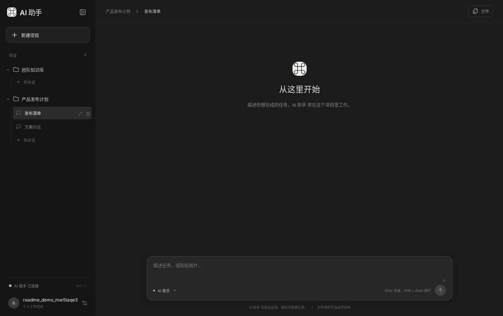
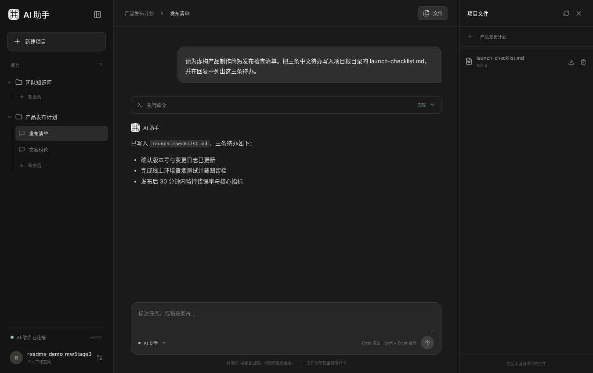
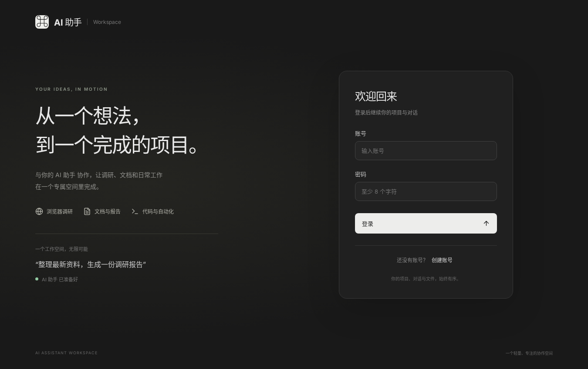

# Docker Codex · AI Assistant and MQTT integration

[简体中文](README.md) · English

Run Codex with Docker Compose so it can execute commands, edit code, and generate files in your project directory. Use the **AI Assistant** in your browser to submit tasks, follow progress, and download results, or connect your own backend to Codex over **MQTT**.

## Screenshots

**Projects and sessions** · Accounts share the execution service's sessions, grouped by working directory, with multiple sessions per directory.



**Chat and results** · Review the task response and download generated files from the same page.



<details>
<summary>See the sign-in page</summary>



</details>

## Quick start

You need Docker and Docker Compose. Run these commands from the repository root.

### 1. Start Codex app-server and MQTT

```bash
docker compose -f docker-compose.yaml up -d
```

If you haven't configured model credentials yet, you can sign in using a device code. Follow the terminal instructions to authorize in your browser, then restart app-server to load the credentials.

```bash
docker compose -f docker-compose-cli.yaml run --rm codex login --device-auth
docker compose -f docker-compose.yaml restart codex-app-server
```

For a backend-only integration, stop here. Connect to the broker at `mqtt://127.0.0.1:1883` from the host. Running tasks requires a working model and credentials. The default MQTT account is for local trials. Replace it before deployment. [MQTT configuration and protocol (Chinese)](app-server/README.md)

### 2. Start the Web AI Assistant

Keep the services from step 1 running. Copy the example configuration before the first startup. Skip the copy if your configuration already exists:

```bash
cp web/.config.json web/config.json
docker compose -f web/docker-compose.yml up -d
```

Before starting, set `mqtt.url` in `web/config.json` to `mqtt://host.docker.internal:1883`, reachable from the Web container. The first startup installs locked dependencies and builds the frontend. Open [http://localhost:3000](http://localhost:3000). Self-registration is enabled by default. To disable it, set `allowRegistration` to `false` in `web/config.json` and restart Web. Existing accounts can still sign in. Existing sessions are read directly from the execution service; to create a project on Linux, enter a name and Web creates `/workspace/<name>` and a session. For a Windows execution service, click through drives and folders to select an existing directory; no absolute-path input is required. Try asking for a three-item launch checklist saved as `launch-checklist.md`, then open **文件** (Files) to download it. [Web configuration and verification (Chinese)](web/README.md)

Web uses one MQTT interface for Docker and Windows desktop. Both bridges forward standard app-server JSON-RPC, so only the MQTT address, port, and credentials change. Sessions come from app-server and files from the execution endpoint. Web needs no workspace mount. Full file support requires bridge forwarding for `fs/*` and chunked transfers. [Windows setup and limitations (Chinese)](web/README.md#连接-windows-桌面)

The first view loads 30 recent sessions and up to 50 history items for the selected session. Load earlier messages from the top or jump back to the latest message. The browser subscribes to content for the selected session, fetches long command output on demand, and previews local reply images as thumbnails. Images support project paths and absolute paths outside the project on the execution endpoint, including desktop bridge temporary images, and are read directly after login authentication. With a compatible execution endpoint, switch to Plan mode below the composer. Web renders synchronous and asynchronous questions as cards with choices, written answers, and skipping, and synchronizes pending questions across clients. Asynchronous question availability depends on the execution endpoint and model.

Native Windows uses `mqtt://127.0.0.1:1883`. Containers reach the host through `mqtt://host.docker.internal:1883`. The startup script automatically reinstalls platform-specific dependencies when switching runtime platforms.

## Features and how it works

- **Appearance.** The login page and bottom-left user menu offer Auto, Light, and Dark. Auto is the default: light from 08:00 to 20:00 in the browser’s local time, dark otherwise. Manual choices stay fixed. Preferences are saved in the current browser, synchronized across same-origin tabs, and retained after reload.
- **Multiple users, projects, and sessions.** Accounts provide login only. All accounts share one app-server's sessions, history, tasks, and files. Projects group threads by `cwd`; Web keeps no project or session mapping. Directory groups cannot be renamed. Deleting a project permanently deletes all sessions in that directory, including archived sessions and spawned descendants, while preserving directories and files. This affects all signed-in users and cannot be undone. Deletion is refused while a task is running or descendants belong to another project, and requires endpoint support for `thread/delete`. Individual sessions can still be archived, preserving their history, directory, and files. Session names are saved through `thread/name/set` and verified by reading them back. Legacy desktop bridges can create unnamed sessions; naming requires an updated bridge.
- **Tasks and files.** Stream replies, send follow-up instructions, stop tasks, answer single-question or multi-question prompts, complete MCP forms generated from their schemas (single choice, multiple choice, text, numbers, and yes/no), open external interaction links, attach files with “+”, paste images, and preview reply images. Small files use app-server `fs/*`; large files use shared MQTT chunk transport with progress, SHA-256 verification, retry resume, HTTP Range downloads, and interrupted-transfer cleanup. Attachment count and capacity follow the execution endpoint and MQTT backpressure. PNG, JPEG, WebP, and GIF images are supported. Browse, download, and delete files. Business methods are decided by app-server, while the bridge forwards the standard protocol.
- **Mobile use.** At viewport widths up to 800px, the project menu starts closed. Open it from the top-left button, expand a project to browse its sessions, and select a session to close the drawer. Open files from the top-right button and dismiss either drawer using its close button or backdrop. In the compact layout, Enter adds a new line and the send button submits the message.
- After the execution service confirms session creation or archiving, the interface updates immediately and refreshes the project list in the background.
- **Message times and elapsed time.** User and assistant messages show recorded timestamps in the browser's local time zone. A separator appears at the first timestamp, on a new day, or after a gap of at least 30 minutes. Running tasks update elapsed time every second; completed, stopped, and failed turns retain their duration, and command cards show execution time. Timing is restored from the execution service after refresh or session changes; missing historical timestamps are not fabricated.
- Replies support GitHub Flavored Markdown, including tables, task lists, strikethrough, and footnotes, plus code highlighting and LaTeX equations.
- **Find projects and sessions.** Search by project or session name in the sidebar. Recent sessions initially show eight entries, with twenty more revealed per click. Sessions are ordered by message submission or task completion time, with creation time used for older entries. The sidebar groups recent sessions by working directory and loads up to ten projects initially. Scroll to the bottom and click **Load more projects** to resume reading and append up to ten more. Expanding a project loads the sessions in its directory.
- **Session status.** The sidebar shows a spinner while a task is running. A blue unread dot appears when the task ends in another session or a hidden tab, and clears when you view that session. Unread markers are stored per browser and signed-in account. The reconnect notice clears when the task resumes output or ends.
- **Deployment.** Web runs in an existing Node.js image or native Node.js and stores only login data locally in JSON. Codex manages its own working directories. All accounts share one app-server and execution identity, with no user data isolation. Use this example with trusted users.

The browser connects to the Web backend over HTTP and WebSocket. The backend talks to the bridge over MQTT, and the bridge exchanges JSON-RPC messages with Codex app-server over standard input and output. MQTT credentials stay with the backend.

Subscribe to `codex/+/status` and discover exactly one instance with `attached=true` and `writerReady=true`. Send app-server requests to `codex/<instance>/command`, correlate replies through `reply/<id>`, and receive events through `observed/output`. The Docker bridge also retains the legacy `in/out` envelope interface. [MQTT topics and protocol (Chinese)](app-server/README.md#协议) · [Official OpenAI Codex App Server API documentation](https://developers.openai.com/codex/app-server)

<details>
<summary>Expand CLI, image tools, and advanced configuration</summary>

## Codex CLI reference

The standalone CLI uses the root `docker-compose-cli.yaml`; specify it with `-f` when running CLI commands. MQTT mode uses the default root `docker-compose.yaml`, and Web uses `web/docker-compose.yml`.

### Image tools

Playwright and Chromium headless shell are preinstalled. Use `playwright screenshot --browser chromium https://example.com screenshot.png` or `require('playwright')`. Runtime instructions are mounted from `codex-home/AGENTS.md`. Read each tool's result separately when diagnosing failures.

The image includes curl, wget, file, zip/unzip, Poppler, and Python libraries for Word, PowerPoint, Excel, images, HTTP, and HTML parsing. Headless LibreOffice Writer, Calc, and Impress can convert common Word, Excel, and PowerPoint documents to PDF; `pdftoppm` can then export each page as an image. Use the Python office libraries for structured content extraction. OCR for scanned documents is not included. A single `ffmpeg` executable is also included for reading videos, extracting frames, and creating contact sheets; `ffplay` and `ffprobe` are omitted. Install names and import names can differ, such as `python-pptx` and `pptx`. Static pages can be fetched with curl, and dynamic pages read through Playwright. Python and pip aliases consistently use `/opt/office-venv`, including in login shells.

Network tools include ping, dig, nslookup, nc, ip, and ss. File and text tools include find, tree, du, tar, gzip, rg, jq, sed, awk, diff, patch, and timeout. Network access depends on the destination and host environment. SSH client tools include ssh, scp, sftp, ssh-keygen, ssh-agent, ssh-add, and ssh-keyscan.

Run the offline tool smoke test from a Linux/macOS shell:

```bash
docker run --rm -i --network none --entrypoint bash IMAGE -s < acceptance/tools-smoke.sh
```

It creates and reads office files, converts Word, Excel, and PowerPoint documents to PDFs and page images with LibreOffice, creates a short video and extracts a frame with FFmpeg, captures a browser screenshot and PDF, and checks PDF extraction, rendering, and ZIP tools.

### Initialize and mount directories

To build locally, first copy the configuration template while preserving an existing configuration.

Linux/macOS:

```bash
[ -e codex-home/config.toml ] || cp codex-home/.config.toml codex-home/config.toml
docker build -t docker.cnb.cool/vvllm/codex .
```

PowerShell:

```powershell
if (-not (Test-Path codex-home/config.toml)) { Copy-Item codex-home/.config.toml codex-home/config.toml }
docker build -t docker.cnb.cool/vvllm/codex .
```

| Host directory | Container directory | Purpose |
|---|---|---|
| `./workspace` | `/workspace` | Project files |
| `./codex-home` | `/home/node/.codex` | Configuration, credentials, history, logs |
| `./skills` | `/home/node/.agents/skills` | User skills |

To work on another host project, change the workspace volume to `/home/you/projects/my-project:/workspace`, or `C:/Users/you/projects/my-project:/workspace` on Docker Desktop.

### Authentication

Device-code login is suitable for containers and remote hosts:

```bash
docker compose -f docker-compose-cli.yaml run --rm codex login --device-auth
docker compose -f docker-compose-cli.yaml run --rm codex login status
docker compose -f docker-compose-cli.yaml run --rm codex
```

Credentials are persisted in `codex-home/auth.json`. You can copy an existing file.

Linux/macOS:

```bash
mkdir -p codex-home
cp ~/.codex/auth.json ./codex-home/auth.json
chmod 600 ./codex-home/auth.json
```

PowerShell:

```powershell
New-Item -ItemType Directory -Force codex-home
Copy-Item "$HOME\.codex\auth.json" ".\codex-home\auth.json"
```

Alternatively, create `secrets/auth.json` and enable its commented volume in the CLI Compose file. Keep it writable for token refresh.

For API-key login, use your own key.

Linux/macOS:

```bash
export OPENAI_API_KEY='YOUR_KEY'
printf '%s' "$OPENAI_API_KEY" | docker compose -f docker-compose-cli.yaml run --rm -T -e OPENAI_API_KEY codex login --with-api-key
```

PowerShell:

```powershell
$env:OPENAI_API_KEY='YOUR_KEY'
$env:OPENAI_API_KEY | docker compose -f docker-compose-cli.yaml run --rm -T -e OPENAI_API_KEY codex login --with-api-key
```

### OpenAI-compatible gateway

Edit the relevant fields in `codex-home/config.toml`, avoiding duplicate keys:

```toml
cli_auth_credentials_store = "file"
model = "GATEWAY_MODEL"
model_provider = "relay"
approval_policy = "on-request"
sandbox_mode = "workspace-write"

[model_providers.relay]
name = "OpenAI-compatible relay"
base_url = "https://YOUR_GATEWAY/v1"
env_key = "RELAY_API_KEY"
wire_api = "responses"
```

Pass the gateway key when running:

```bash
docker compose -f docker-compose-cli.yaml run --rm -e RELAY_API_KEY='YOUR_KEY' codex
docker compose -f docker-compose-cli.yaml run --rm -T -e RELAY_API_KEY='YOUR_KEY' codex exec "Inspect this project and summarize its stack and startup steps"
```

The gateway must support the Responses API used by Codex. Use the gateway's own credentials and evaluate its access to prompts and code.

### Skills and common commands

Put user skills in `skills/NAME/SKILL.md`. Compose mounts them read-only at `/home/node/.agents/skills`. The included example can be selected through `/skills` or called with `$example-skill Inspect this project`. Project skills belong in `.agents/skills/NAME/SKILL.md` within the mounted project.

The base image and Playwright are pinned at the top of Dockerfile. Codex defaults to npm's `latest` release, and Python dependencies are pinned in [requirements.txt](requirements.txt). Fetching a newer Codex requires rerunning its installation layer during a rebuild. Existing images do not update automatically.

```bash
# Version, interactive CLI, and one-shot task
docker compose -f docker-compose-cli.yaml run --rm codex --version
docker compose -f docker-compose-cli.yaml run --rm codex
docker compose -f docker-compose-cli.yaml run --rm -T codex exec "Read the project and write an architecture summary"
# Container shell and temporary project mount
docker compose -f docker-compose-cli.yaml run --rm --entrypoint bash codex
docker compose -f docker-compose-cli.yaml run --rm -v /path/to/project:/workspace codex
# Refresh Codex from npm latest; other versions are pinned in Dockerfile and requirements.txt
docker build --pull --no-cache -t docker.cnb.cool/vvllm/codex .
# Override the Codex version for one build
docker build --build-arg CODEX_VERSION=0.xxx.x -t docker.cnb.cool/vvllm/codex .
```

### Credentials and sandbox settings

Keep `auth.json` private and out of Git. Use trusted gateways and keep ChatGPT login credentials private. Remove the skills volume's `:ro` only when skill editing is needed. Mount only the project directories needed for the task.

If the host blocks nested sandbox creation and reports namespace or bwrap errors, test the following after reviewing the mounted directories:

```bash
docker compose -f docker-compose-cli.yaml run --rm codex --sandbox danger-full-access
docker compose -f docker-compose-cli.yaml run --rm -T --interactive=false codex --sandbox danger-full-access --ask-for-approval never exec --skip-git-repo-check "ping"
```

The second command disables terminal interaction and approval prompts and allows a non-Git working directory. Full access removes Codex's additional in-container sandbox, giving it access to all mounted content. Review mounts accordingly.

</details>
