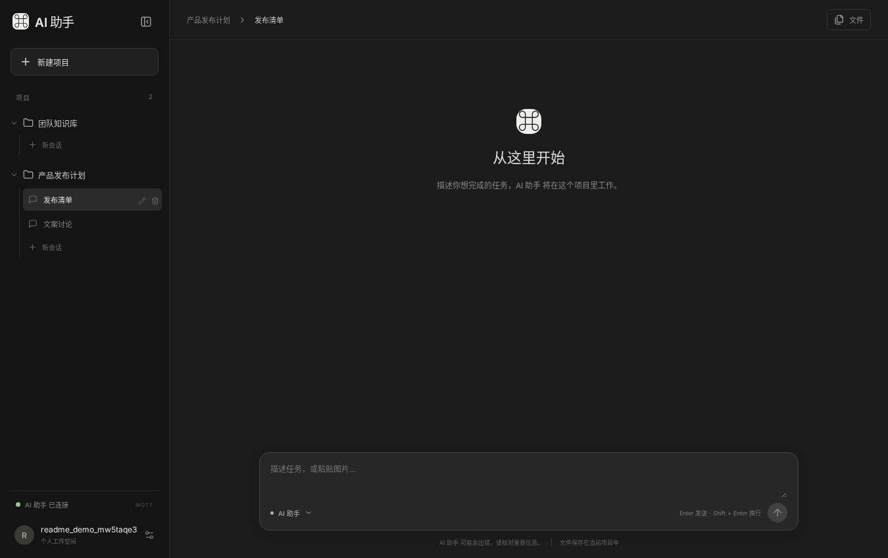
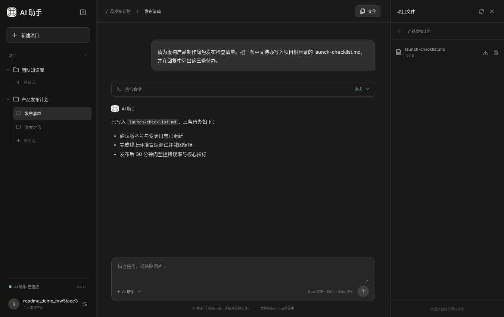
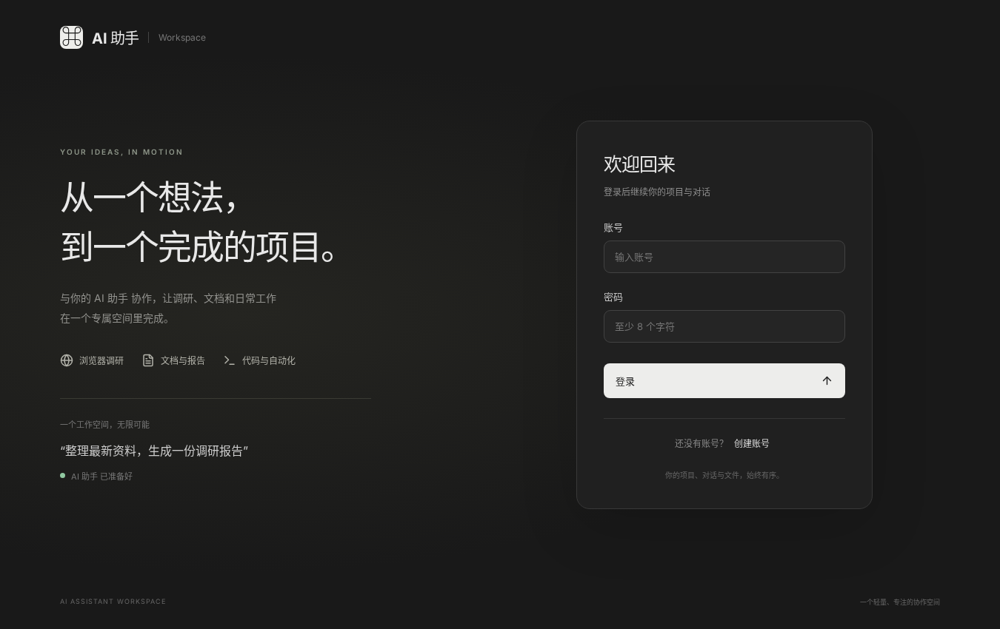

# Docker Codex · AI 助手与 MQTT 接入

简体中文 · [English](README.en.md)

用 Docker Compose 运行 Codex，让它在你的项目目录里执行命令、修改代码、生成文件。可以在浏览器里用 **AI 助手** 发任务、查看进度和下载成果，也可以让自己的后端通过 **MQTT** 调用 Codex。

## 效果图

**项目与会话** · 每个账号可以创建多个项目，一个项目下可以开多个会话。



**聊天与成果** · 在同一页面查看任务回复和生成的文件，可直接下载。



<details>
<summary>查看登录界面</summary>



</details>

## 快速启动

需要 Docker 和 Docker Compose。以下命令都在仓库根目录执行。

### 1. 启动 Codex app-server + MQTT

```bash
docker compose -f docker-compose.yaml up -d
```

首次使用且尚未配置模型认证时，可以用设备码登录。按终端提示在浏览器完成授权，然后重启 app-server 以加载认证。

```bash
docker compose -f docker-compose-cli.yaml run --rm codex login --device-auth
docker compose -f docker-compose.yaml restart codex-app-server
```

只做后端集成，到这一步即可。宿主机可通过 `mqtt://127.0.0.1:1883` 连接 Broker。实际执行任务需要可用的模型和认证。默认 MQTT 账号用于本地试用，部署前请更换。 [MQTT 配置与协议](app-server/README.md)

### 2. 启动 Web（AI 助手）

保持上一步的服务运行，再执行：

```bash
docker compose -f web/docker-compose.yml up -d
```

首次启动会安装锁定的依赖并构建前端。打开 [http://localhost:3000](http://localhost:3000)，注册账号，然后按 **新建项目 → 新会话 → 发送消息** 试用。可以发「生成一份三条待办的发布清单，保存为 launch-checklist.md」，再点右上角 **文件** 查看并下载成果。 [Web 配置与验收](web/README.md)

## 功能与工作原理

- **多用户、多项目、多会话**。每个账号管理自己的项目。项目内的各个会话有独立历史，共享该项目的文件。
- **任务与文件**。支持流式回复、追加要求、停止任务、粘贴图片、预览回复图片，以及浏览、下载和删除项目文件。Web 默认允许所有用户合计运行 4 个任务，同一会话同时运行 1 个任务。
- **部署方式**。Web 和 Codex 共用宿主机的 `workspace/`，Web 使用现成的 Node.js 镜像和文件存储。所有账号共享一个 app-server 和运行身份，适用于可信用户的示例环境。

浏览器通过 HTTP 和 WebSocket 连接 Web 后端。业务后端通过 MQTT 与桥接进程通信，桥接进程再通过标准输入和输出与 Codex app-server 交换 JSON-RPC 消息。MQTT 凭据由业务后端持有。

接入时，先订阅 `codex/admin/status` 和 `codex/admin/out`，等状态为 `ready` 后，用当前 `runId` 向 `codex/admin/in` 发送请求，例如 `thread/start` 或 `turn/start`，再从 `out` 读取响应和流式事件。 [本仓库 MQTT 信封与主题](app-server/README.md#协议) · [OpenAI 官方 Codex App Server API 文档](https://developers.openai.com/codex/app-server)

<details>
<summary>展开 Codex CLI、镜像工具与高级配置</summary>

## Codex CLI 参考

独立 CLI 使用根目录 `docker-compose-cli.yaml`，命令需通过 `-f` 指定该文件。MQTT 服务模式使用默认的 `docker-compose.yaml`，配置和消息协议见 [app-server 服务说明](app-server/README.md)。

Web 前后端示例位于 [web/](web/README.md)，使用该目录下的 `docker-compose.yml` 启动，与 Codex 共享 workspace，不需要数据库或构建新镜像。

镜像已预装 Node.js Playwright 与 Chromium headless shell，无需在任务中安装浏览器。可直接执行 `playwright screenshot --browser chromium https://example.com screenshot.png`，或通过 `require('playwright')` 使用默认无头浏览器。`codex-home/AGENTS.md` 提供运行说明，随现有目录挂载进入服务；不要将多个工具探测命令的非零退出码误认为浏览器缺失。

常用工具包括 curl、wget、file、zip/unzip、Poppler，以及 Python 的 python-docx、python-pptx、openpyxl、Pillow、requests、BeautifulSoup。LibreOffice Writer、Calc、Impress 无界面版可将常见 Word、Excel、PPT 文档转成 PDF，再用 `pdftoppm` 按页导出图片；结构化内容提取优先使用 Python 办公库，扫描件 OCR 不在当前镜像范围内。镜像还预装单个 `ffmpeg` 可执行文件，可读取视频、按时间抽帧并制作联系表；不含 `ffplay`、`ffprobe`。PPT 包的安装名是 `python-pptx`，导入名为 `pptx`；Playwright 没有 `fetch` 子命令，静态网页用 curl，动态网页通过 Playwright API 提取。python/python3 与 pip/pip3 统一使用 `/opt/office-venv`，避免登录 Shell 切换 PATH 后使用错误环境。

系统命令补充网络诊断（ping、dig、nslookup、nc、ip、ss）、文件处理（find、tree、du、tar、gzip、zip/unzip）和文本处理（rg、jq、sed、awk、diff、patch、timeout）。不额外安装进程排查工具。网络命令已安装不代表目标站点允许 ICMP 或端口访问，需按实际网络结果判断。

SSH 客户端随镜像预装，包含 ssh、scp、sftp、ssh-keygen、ssh-agent、ssh-add、ssh-keyscan；用于远程连接、文件传输及密钥管理，不安装 SSH 服务端。

镜像工具可在断网环境验收：`docker run --rm -i --network none --entrypoint bash 镜像名 -s < acceptance/tools-smoke.sh`（Linux/macOS Shell）。验收实际创建并读取 Word、Excel、PPT，使用 LibreOffice 转换三类办公文档并逐页生成图片，使用 FFmpeg 生成短视频并抽帧，启动预装浏览器生成截图和 PDF，检查 PDF 提取、渲染及 ZIP 工具。

这个示例用于记录并快速复用 Codex CLI 的常用 Docker 命令，包括：

- ChatGPT Device Code 登录
- 持久化或挂载 `auth.json`
- API Key 登录
- OpenAI-compatible 中转/API 网关
- 用户级技能和项目级技能挂载
- 交互式与非交互式调用

## 目录结构

```text
.
├── Dockerfile
├── docker-compose.yaml         # 默认的 app-server + MQTT 服务
├── docker-compose-cli.yaml     # 独立 CLI
├── codex-home/
│   ├── .config.toml       # 仓库配置模板
│   └── config.toml        # 本地配置，由模板复制，Git 忽略
├── skills/
│   └── example-skill/
│       └── SKILL.md
└── workspace/
```

容器内路径：

| 宿主机 | 容器内 | 用途 |
|---|---|---|
| `./workspace` | `/workspace` | Codex 操作的项目 |
| `./codex-home` | `/home/node/.codex` | 配置、认证、历史、日志 |
| `./skills` | `/home/node/.agents/skills` | 用户级技能 |

## 1. 初始化

首次使用时，从模板生成本地 `config.toml`。下面的命令会保留已有配置。

Linux/macOS：

```bash
[ -e codex-home/config.toml ] || cp codex-home/.config.toml codex-home/config.toml
docker build -t docker.cnb.cool/vvllm/codex .
```

Windows PowerShell：

```powershell
if (-not (Test-Path codex-home/config.toml)) { Copy-Item codex-home/.config.toml codex-home/config.toml }
docker build -t docker.cnb.cool/vvllm/codex .
```

默认操作当前目录下的 `workspace`。要操作真实项目，直接修改 Compose 中的工作目录挂载：

```yaml
- /home/you/projects/my-project:/workspace
```

Windows Docker Desktop 示例：

```yaml
- C:/Users/you/projects/my-project:/workspace
```

## 2. 推荐登录：Device Code

容器或远程环境优先使用 Device Code：

```bash
docker compose -f docker-compose-cli.yaml run --rm codex login --device-auth
```

浏览器完成授权后，凭据会写入：

```text
./codex-home/auth.json
```

检查登录状态：

```bash
docker compose -f docker-compose-cli.yaml run --rm codex login status
```

启动交互式 Codex：

```bash
docker compose -f docker-compose-cli.yaml run --rm codex
```

## 3. 使用宿主机已有的 auth.json

当前 Compose 已将整个 `./codex-home` 挂载为容器的 `CODEX_HOME`。最简单的方法是把已有认证文件复制进去。

Linux/macOS：

```bash
mkdir -p codex-home
cp ~/.codex/auth.json ./codex-home/auth.json
chmod 600 ./codex-home/auth.json
docker compose -f docker-compose-cli.yaml run --rm codex login status
```

Windows PowerShell：

```powershell
New-Item -ItemType Directory -Force codex-home
Copy-Item "$HOME\.codex\auth.json" ".\codex-home\auth.json"
docker compose -f docker-compose-cli.yaml run --rm codex login status
```

也可以只挂载单个文件。先创建 `secrets/auth.json`，再取消 `docker-compose-cli.yaml` 中这行注释：

```yaml
- ./secrets/auth.json:/home/node/.codex/auth.json
```

注意：`auth.json` 会在令牌刷新时被 Codex 更新，因此不要用只读挂载。

## 4. 使用 OpenAI API Key

Linux/macOS：

```bash
export OPENAI_API_KEY='你的密钥'
printf '%s' "$OPENAI_API_KEY" \
  | docker compose -f docker-compose-cli.yaml run --rm -T -e OPENAI_API_KEY codex login --with-api-key
```

Windows PowerShell：

```powershell
$env:OPENAI_API_KEY='你的密钥'
$env:OPENAI_API_KEY |
  docker compose -f docker-compose-cli.yaml run --rm -T -e OPENAI_API_KEY codex login --with-api-key
```

检查：

```bash
docker compose -f docker-compose-cli.yaml run --rm codex login status
```

## 5. 使用中转/API 网关

这里的“中转”按 OpenAI-compatible API 网关处理，通常使用中转方提供的独立 API Key，而不是把 ChatGPT 的 `auth.json` 交给中转方。

在 `codex-home/config.toml` 中配置以下内容，模型名称和地址按中转服务修改；已有配置只修改对应字段，不要重复添加同名字段：

```toml
cli_auth_credentials_store = "file"
model = "中转支持的模型名"
model_provider = "relay"
approval_policy = "on-request"
sandbox_mode = "workspace-write"

[model_providers.relay]
name = "OpenAI-compatible relay"
base_url = "https://你的中转地址/v1"
env_key = "RELAY_API_KEY"
wire_api = "responses"
```

启动时直接传入中转密钥：

```bash
docker compose -f docker-compose-cli.yaml run --rm -e RELAY_API_KEY='你的中转密钥' codex
```

非交互调用：

```bash
docker compose -f docker-compose-cli.yaml run --rm -T -e RELAY_API_KEY='你的中转密钥' codex exec \
  "检查当前项目，输出技术栈、启动方式和明显问题"
```

前提：中转服务必须兼容 Codex 使用的 Responses API。仅兼容传统 Chat Completions 接口的中转不一定可用。

## 6. 挂载和调用技能

### 用户级技能

将技能放在：

```text
skills/<技能名>/SKILL.md
```

Compose 会将整个 `skills` 目录只读挂载到：

```text
/home/node/.agents/skills
```

示例已经包含：

```text
skills/example-skill/SKILL.md
```

进入 Codex 后可以：

```text
/skills
```

或者在提示词中显式调用：

```text
$example-skill 检查当前项目
```

### 项目级技能

项目专用技能可以直接放到项目中：

```text
<项目根目录>/.agents/skills/<技能名>/SKILL.md
```

因为项目根目录已挂载到 `/workspace`，Codex 会自动发现这些技能。

## 7. 常用命令

查看版本：

```bash
docker compose -f docker-compose-cli.yaml run --rm codex --version
```

交互式运行：

```bash
docker compose -f docker-compose-cli.yaml run --rm codex
```

一次性执行任务：

```bash
docker compose -f docker-compose-cli.yaml run --rm -T codex exec \
  "阅读项目并生成一份中文架构说明"
```

进入容器 Shell：

```bash
docker compose -f docker-compose-cli.yaml run --rm --entrypoint bash codex
```

临时挂载另一个项目：

```bash
docker compose -f docker-compose-cli.yaml run --rm -v /path/to/project:/workspace codex
```

更新 Codex CLI：

```bash
docker build --pull --no-cache -t docker.cnb.cool/vvllm/codex .
```

Dockerfile 顶部集中维护基础镜像和 Playwright 的固定值，Codex 默认使用 `latest` 跟随 npm 最新正式版。Python 依赖固定版本维护在 [requirements.txt](requirements.txt)。重建时需重新执行 Codex 安装层才能获取新版，已有镜像不会自动更新。临时指定 Codex 版本可用：

```bash
docker build --build-arg CODEX_VERSION=0.xxx.x -t docker.cnb.cool/vvllm/codex .
```

## 8. 安全注意事项

1. `auth.json` 包含访问令牌，应视同密码，不能提交到 Git、发到群聊或上传到工单。
2. 中转服务可能看到提示词、代码内容和 API 请求，仅使用可信服务。
3. 不建议把 ChatGPT 登录产生的 `auth.json` 发送给第三方中转；普通中转优先使用其独立 API Key。
4. `skills` 默认只读挂载；Codex 需要创建或修改技能时，可临时移除 `:ro`。
5. 只挂载需要 Codex 操作的项目，不要直接挂载整个用户主目录。

## 9. Docker 内沙箱问题

Codex 自身还会使用文件系统沙箱。若宿主机内核不允许容器继续创建嵌套沙箱，可能出现 namespace 或 `bwrap` 相关错误。

在确认容器本身只挂载了可信目录后，可临时测试：

```bash
docker compose -f docker-compose-cli.yaml run --rm codex --sandbox danger-full-access
```

完整的非交互调用示例：

```bash
docker compose -f docker-compose-cli.yaml run --rm -T --interactive=false codex --sandbox danger-full-access --ask-for-approval never exec --skip-git-repo-check "ping"
```

其中 `-T --interactive=false` 禁用终端交互，`--ask-for-approval never` 禁用审批提示，`--skip-git-repo-check` 允许在非 Git 仓库中执行任务。

这会关闭 Codex 在容器内部的额外沙箱，不等于关闭 Docker 隔离，但会让 Codex 能访问容器内所有已挂载内容，因此不要挂载无关敏感目录。

</details>
